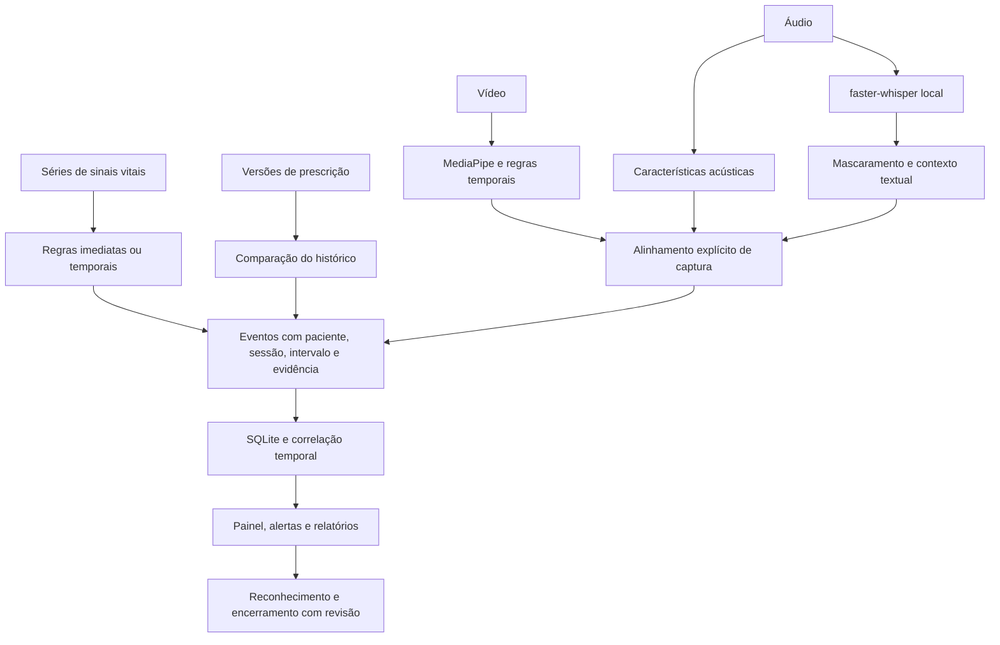

# Relatório técnico — Monitoramento multimodal local

**Tech Challenge FIAP — Fase 4**

**Versão documental:** 13/11/2026

**Repositório:** https://github.com/caiodesigner/challenge-fiap-fase-4

**Estado:** implementação e ensaios funcionais documentados; avaliação representativa e vídeo final pendentes.

## 1. Objetivo e escopo adotado

O projeto demonstra monitoramento de adultos sintéticos em internação e
reabilitação. Processa sinais vitais, postura/movimentação em vídeo, áudio,
menções textuais e versões de prescrições, gerando eventos explicáveis e alertas
para revisão humana. O alerta é emitido automaticamente; o profissional pode
reconhecer e depois encerrar, registrando a revisão.

Por decisão do autor, a solução ativa executa localmente: faster-whisper para
transcrição, MediaPipe para postura e regras locais para acústica, contexto
textual, séries clínicas e correlação. O enunciado original menciona Azure
Speech e Text Analytics; a substituição é uma adaptação de escopo documentada.
Não há análise de sentimentos ou extração genérica de palavras-chave local.
Adaptadores Azure anteriores permanecem opcionais no código.

As demonstrações usam dados sintéticos e associações explicitamente artificiais
entre fontes. O sistema não recomenda tratamentos ou doses. As regras de
severidade e os limites numéricos foram definidos para o experimento acadêmico.

## 2. Evolução da fase anterior

A fase 3 foi preservada em seu repositório. A extração seletiva tomou como
referência o commit `66f0a07544202f8dd241b41edb79d12962d5f5ea`, trazendo regras de
mascaramento textual, auditoria e leitura parametrizada de contexto clínico.
O inventário registra origem, adaptações e hashes em
[reaproveitamento-fase-3.md](reaproveitamento-fase-3.md) e
[reaproveitamento-manifest.json](reaproveitamento-manifest.json).

Os processadores, contratos multimodais, monitor incremental, histórico de
prescrições, fusão e painel foram desenvolvidos para a fase 4. Pesos, caches,
bancos e resultados de treinamento da fase 3 não foram copiados como evidência
experimental desta entrega. Não houve novo fine-tuning nesta fase.

O feedback anterior motivou comparação pareada entre alternativas e registro de
regressões. A necessidade de ampliar exemplos continua aberta, principalmente
para voz natural, movimentos e referências independentes.

## 3. Arquitetura e fluxo

Os contratos Pydantic exigem identificadores, unidades compatíveis e horários
com fuso. Ocorrência e processamento são campos distintos. Os relatórios de mídia
atuais usam início do processamento como origem; a integração à sessão exige
horário de captura informado ou associação marcada como sintética.

O SQLite registra sessões, amostras, estado dos detectores, eventos, alertas,
reproduções e revisões. A extensão clínica adiciona versões de prescrição,
disponibilidade das modalidades, configuração e origem dos eventos importados.
Chaves determinísticas evitam duplicações em reprocessamentos idênticos.

Os processadores de mídia geram JSON e Markdown; o vídeo inclui arquivo anotado.
O painel Streamlit reúne sinais vitais, vídeo, áudio e histórico/fusão. Falhas ou
disponibilidade desconhecida ficam visíveis, sem bloquear fontes independentes.

## 4. Tecnologias e ambiente

| Componente | Papel e configuração verificada |
| --- | --- |
| Python e Pydantic | Contratos, ingestão e regras; ambiente local Python 3.14.4, suporte declarado 3.12–3.14 |
| SQLite | Persistência transacional e histórico de alertas |
| Streamlit | Painel local e exportações |
| faster-whisper 1.2.1 | Transcrição em português, modelo small, CPU/int8, quatro threads; medium disponível para comparação |
| CTranslate2 4.8.5 e PyAV 16.1.0 | Execução do Whisper e decodificação; PyAV limitado à série 16 testada |
| MediaPipe 0.10.35 | Pose Landmarker Lite em CPU |
| OpenCV e FFmpeg | Leitura de vídeo, marcações e conversão para reprodução no navegador |
| Pytest, Ruff e Mypy | Testes funcionais, estilo e tipos |

Os modelos ficam fora do Git em `models/`. O download inicial requer internet;
a análise carrega os pesos locais. O computador informado possui i7-10750H,
32 GB de RAM e GTX 1650 de 4 GB. O ambiente do agente não expôs dispositivos
CUDA; os resultados registrados são de CPU. Não foi validada execução em GPU.

As versões de bibliotecas constam dos relatórios de instalação e avaliação.
As instruções com revisões dos modelos estão em [execucao-local.md](execucao-local.md).
Não foram realizados gastos com APIs nesta execução; o processamento usa recursos locais.

## 5. Dados e referências

O manifesto contém 90 casos funcionais sintéticos, cinco por frente em cada
partição: sinais, prescrições, vídeo, movimentação, áudio e texto. Três pacientes
sintéticos possuem sessões distintas. O catálogo registra hashes, origem,
formato, resultado esperado e base dos rótulos.

Há também seis registros públicos de séries numéricas BIDMC, separados por
fonte, com licença e manifesto em `data/external/bidmc/`. A comparação de eventos
apresentada aqui foi executada sobre fixtures sintéticas, não sobre os registros
BIDMC como se possuíssem rótulos de anomalia.

Parte das fixtures de mídia contém características artificiais ou tons técnicos,
sem fala ou vídeo clínico. Os ensaios reais dos motores usam uma imagem repetida
e fala eSpeak NG sintetizada. Esses materiais verificam execução, formatos e
falhas; sua representatividade é limitada.

As partições do catálogo compartilham templates de geração e não equivalem a um
teste clínico independente. Nesta etapa de avaliação foi usada a partição de
desenvolvimento. Gravações naturais consentidas/licenciadas, referências manuais
e teste independente por pessoa/locutor continuam pendentes.

## 6. Processamento implementado

### Sinais vitais

As regras cobrem frequência cardíaca, pressão sistólica/diastólica e SpO₂.
A solução temporal exige três segundos de desvio e controla lacunas, qualidade,
ordenação e duplicação. A baseline usa os mesmos limites, filtros e SQLite,
com confirmação imediata, configurada como zero segundos. A configuração padrão
permanece em três segundos.

A reprodução tem modo acelerado e cadência 1×, com registro separado do tempo de
processamento e do atraso desde confirmação/início. São simulações de séries
gravadas. Não foi implementado detector específico da classe `trend_deviation`.

### Vídeo e movimentação

O Pose Landmarker Lite fornece pontos posturais; regras exploratórias observam
assimetria/interrupção no exercício e candidatos a levantar/alterações de
atividade no contexto de internação. O pipeline sinaliza pessoa ausente,
qualidade insuficiente e lacunas. Gera intervalos, características, relatório
e vídeo anotado. A validação com movimentos e referências independentes está pendente.

### Áudio e texto

O pipeline verifica WAV mono PCM 16-bit, 16 kHz, com duração de 0,3 a 30 segundos.
Calcula energia, pausas, silêncio e clipping, com referência acústica opcional.
O Whisper gera a transcrição local. O texto sanitizado passa por regras de
menção, negação, sujeito e temporalidade antes da geração de eventos.

Energia e pausas não comprovam disartria ou fadiga. Sentimento e diagnóstico
não são inferidos por essas regras. Menções textuais usam o início do relato;
não existe alinhamento clínico por palavra integrado à fusão.

### Prescrições

O histórico compara a última versão aceita do mesmo medicamento na sessão.
Mudanças previstas exigem motivo. Alterações não previstas com razão entre doses
≥ 2, transições de zero para dose positiva e interrupções podem gerar eventos.
Unidades incompatíveis e transições inválidas geram observações e não atualizam
o estado aceito. As unidades são sintéticas; não há conversão farmacológica.

### Fusão e revisão

Eventos elegíveis do mesmo paciente e sessão, com inícios a até 30 segundos,
podem gerar alerta combinado. Áudio/texto formam uma família; vídeo/movimentação,
outra, evitando reforço entre visões dependentes da mesma fonte. O mecanismo
atual gera pares e mantém os alertas isolados.

Severidades experimentais: observação de consistência, atenção para evento
isolado elegível e prioridade para correlação. A emissão antecede a revisão.
Estados aberto, reconhecido e encerrado preservam responsável, comentário e
resultado da revisão. O painel usa identidade de demonstração, sem autenticação
profissional de produção.

## 7. Avaliação e resultados

O protocolo de `configs/evaluation.json` define pareamento um a um por paciente,
sessão e classe. Séries usam tolerância de cinco segundos; texto/prescrições usam
identidade do registro. Contagens e denominadores acompanham métricas; resultado
indefinido é `null`. Não foram alterados rótulos após observar as previsões.

### Comparação de regras nas mesmas entradas

| Alternativa | TP | FP | FN | Precisão | Recall | F1 |
| --- | --- | --- | --- | --- | --- | --- |
| Sinais, imediata | 1 | 6 | 1 | 0,143 | 0,500 | 0,222 |
| Sinais, temporal | 1 | 4 | 1 | 0,200 | 0,500 | 0,286 |
| Alteração inesperada de dose | 1 | 0 | 0 | 1,000 | 1,000 | 1,000 |

Fonte: [development.json](../reports/evaluation/development.json).
Foram cinco casos de sinais e cinco de prescrição; um caso inválido de sinais
foi rejeitado nas duas alternativas e aparece separadamente.

A anotação de sinais possui um rótulo de episódio para quatro sinais alterados.
O protocolo aceita um evento e conta três como extras. Isso limita a
interpretação da precisão. A classe de tendência não foi reconhecida. As metas
experimentais de precisão/recall ≥ 0,80 não foram atingidas nos sinais agregados.
O único caso positivo de dose não estima generalização; eventos de unidade,
sequência e interrupção sem referências completas permanecem fora dessa métrica.

Foram 38 segundos negativos de sinais e 45 de prescrições, sem FP das classes
avaliadas. A exposição é curta para estimar estabilidade de falsos alertas.

### Latência

No caso `development-vitals-2` reproduzido em 1×, a regra temporal teve p95 de
aproximadamente **15,2 ms após a confirmação** e **3,015 s desde o início** do
desvio. A baseline imediata teve aproximadamente 15,6 ms em ambas as medidas.
A janela de três segundos explica a diferença. A medição inclui a persistência
nessa reprodução; não inclui sensores, rede ou modelos de mídia.
Fonte: [cadence-development.json](../reports/evaluation/cadence-development.json).

### Reconhecimento de fala e postura

Sete sondas sintéticas de fala produziram WER ponderado de 39,6% com small e 25%
com medium. No áudio original de oito palavras, ambos perderam “falta de ar”,
com três erros de edição. Isso mantém a revisão manual e a avaliação com fala
natural como pendências. Fonte:
[speech-recognition-comparison.json](../reports/validation/speech-recognition-comparison.json).

A execução real de postura em imagem repetida identificou dez quadros avaliáveis;
a ausência de pessoa também foi exercitada. Esses ensaios verificam o motor e a
codificação de vídeo, sem comprovar detecção de desvios clínicos.

### Volume da fusão e robustez

A demonstração sintética produziu sete eventos, sete alertas isolados e 15
combinados: 22 alertas. O crescimento por pares indica necessidade de estudar
redundância e agrupamento. Faltam referências multimodais para calcular precisão
e recall da fusão. Fonte: [stage-clinical-fusion.json](../reports/validation/stage-clinical-fusion.json).

A suíte passou com **113 testes**, além de Ruff, formatação e Mypy. Os testes
cobrem contratos, contexto textual, isolamento, rejeição de formatos, persistência,
reprocessamento, transições de alerta, limites da janela e rollback de lotes.
Essas verificações não substituem qualidade do detector ou avaliação de mídia.

## 8. Reprodutibilidade e rastreabilidade

O [guia de entrega](guia-entrega.md) reúne instalação e execução. A
[matriz de atendimento](matriz-atendimento.md) relaciona requisitos, código,
comandos e evidências. O [roteiro do vídeo](roteiro-video.md) organiza a demonstração
em 13min30s. Os resultados JSON incluem configurações, hashes, ambiente, entradas,
previsões e referências por caso. Modelos e arquivos gerados continuam fora do Git.

O código possui licença declarada `LicenseRef-Proprietary`; materiais externos
mantêm seus avisos. O manifesto da extração documenta as atribuições da fase 3.

## 9. Limitações e fechamento da entrega

As limitações conhecidas são: dados sintéticos e poucos locutores/fontes,
granularidade incompleta dos rótulos, detector de tendência ausente, omissão de
termo crítico pelo Whisper, latência medida em uma série curta, importação de
mídia com origem temporal informada e volume de alertas por pares.

Antes do fechamento, faltam avaliar fala/vídeo representativos, revisar as
referências e o detector de tendência, comparar a utilidade da fusão e executar
o teste reservado. Também faltam gravar, conferir e publicar o vídeo final com
até 15 minutos, registrando seu link. O estado da entrega está em
[entrega.json](entrega.json). A documentação descreve as evidências atuais e deve
ser revisada quando esses resultados forem ampliados.
