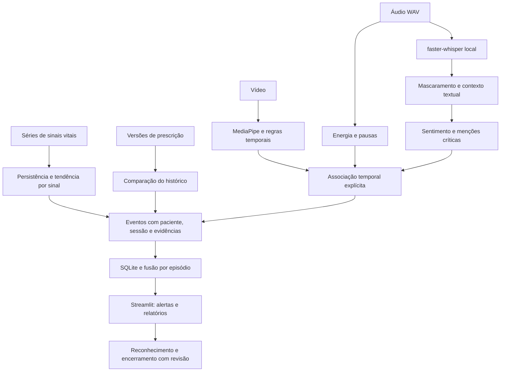

# Relatório técnico — Monitoramento multimodal local

**Tech Challenge FIAP — Fase 4**

**Autor:** Caio Lucas Santos Silva — trabalho individual.

**RM:** RM373689  |  **Turma:** 9IADT

**Repositório:** https://github.com/caiodesigner/challenge-fiap-fase-4

**Revisão:** processamento local, tendências por sinal, fusão por episódio e regras posturais v2.

**Vídeo de apresentação:** link e duração pendentes.

**Commit de entrega:** registrar após o fechamento das alterações.

## 1. Objetivo e atendimento ao desafio

O projeto demonstra análise de dados multimodais para monitoramento preventivo:
sinais vitais, versões de prescrições, áudio, texto e vídeos de fisioterapia ou
movimentação em cadeira. A aplicação transforma observações em eventos com
intervalos e evidências, correlaciona fontes e emite alertas para revisão humana.
O escopo é acadêmico; os limiares não foram validados para decisões clínicas.

O PDF original está preservado em
[IADT - Fase 4 - Tech challenge.pdf](IADT%20-%20Fase%204%20-%20Tech%20challenge.pdf).
Conforme orientação do professor relatada pelo autor, o uso de Azure é opcional.
A entrega adota execução local: faster-whisper para transcrição, regras em
português para sentimentos e menções críticas, MediaPipe para postura e regras
para séries temporais e correlação. Os adaptadores Azure permanecem opcionais.
OpenPose e YOLOv8 são exemplos no enunciado; a implementação postural usa MediaPipe.

| Frente | Implementação demonstrada | Evidência |
| --- | --- | --- |
| Fisioterapia | Assimetria entre braços e interrupção exploratória | Processamento real de trechos REHAB24-6; assimetria confirmada em um exemplo |
| Cadeira/internação | Centro do tronco, candidato a levantamento e mudança de atividade | Processamento real do par Sit-To-Stand; um candidato a levantamento |
| Áudio | Transcrição, pausas, características acústicas e termos críticos | SPIRA e gravação encenada do autor |
| Sentimentos | Vocabulário e regras em português, com negação e contexto | Testes automatizados e exemplos no painel |
| Sinais vitais | Desvio persistente e tendência por sinal | Avaliação sintética e reprodução no painel |
| Prescrições | Mudanças inesperadas, interrupções e inconsistências | Histórico sintético versionado |
| Alertas e fusão | Correlação por episódio, reconhecimento e encerramento | Avaliação sintética e importação de relatórios no painel |

A análise acústica identifica indícios observáveis, como pausas; não diagnostica
disartria, fadiga ou dificuldade respiratória. A detecção de interrupção e de
mudança de atividade tem testes funcionais, mas não foi demonstrada nos trechos
externos selecionados como evento positivo validado.

## 2. Arquitetura e fluxo multimodal



Contratos Pydantic validam identidades, unidades, intervalos e horários com fuso.
Ocorrência e processamento são registrados separadamente. SQLite armazena
amostras, eventos, alertas, prescrições, execuções e revisões. Chaves determinísticas
permitem deduplicação de ingestões idênticas.

O painel apresenta quatro áreas: Sinais vitais, Vídeo, Áudio e Histórico e fusão.
Áudio e vídeo produzem JSON e Markdown; vídeo também produz mídia anotada.
Os relatórios registram configurações, versões dos detectores e hash da entrada.

A origem temporal inicial dos relatórios de mídia é o começo do processamento,
não o horário real da gravação. Para integrar eventos, o usuário informa uma
origem de captura com fuso e o tipo de associação. Fontes independentes utilizadas
neste trabalho são vinculadas como **associação sintética de demonstração**.
Isso não comprova simultaneidade nem acompanhamento do mesmo paciente real.

## 3. Tecnologias e execução

| Componente | Uso |
| --- | --- |
| Python/Pydantic | Contratos, validação e processamento; ambiente verificado Python 3.14.4 |
| SQLite | Persistência e rastreabilidade |
| Streamlit | Interface local |
| faster-whisper 1.2.1 | Whisper small em português, CPU/int8 |
| CTranslate2/PyAV | Inferência e decodificação de áudio |
| MediaPipe 0.10.35 | Pose Landmarker Lite em CPU |
| OpenCV/FFmpeg | Decodificação, marcações e vídeo para navegador |
| Pytest/Ruff/Mypy | Testes, estilo, formatação e tipos |

Pesos ficam em `models/`, fora do Git. Seu preparo inicial requer download;
as análises documentadas usam modelos locais. O computador informado pelo autor
possui i7-10750H, 32 GB de RAM e GTX 1650 de 4 GB. As execuções registradas foram
em CPU; a execução em GPU não foi validada. Não houve chamadas à nuvem nas
análises locais documentadas.

Instalação, preparo dos modelos e execução estão em
[execucao-local.md](execucao-local.md) e [guia-entrega.md](guia-entrega.md).
Para iniciar o painel após o preparo do ambiente:

```bash
.venv/bin/python -m streamlit run app.py
```

A fase 3 foi preservada em seu repositório. Foram reaproveitados componentes
selecionados de mascaramento textual, auditoria e contexto, com origem e hashes em
[reaproveitamento-fase-3.md](reaproveitamento-fase-3.md) e
[reaproveitamento-manifest.json](reaproveitamento-manifest.json).
Não houve novo fine-tuning nesta fase.

## 4. Métodos implementados

### 4.1 Sinais vitais

São processados frequência cardíaca, pressão sistólica/diastólica e SpO₂.
A configuração sintética padrão exige três segundos de desvio para confirmação,
controlando qualidade, lacunas e ordem temporal. A alternativa imediata usa os
mesmos limites sem aguardar persistência. O detector de tendência considera
progressão monotônica, janela de quatro segundos e variação mínima relativa à
faixa configurada, produzindo `trend_deviation` por sinal.

A reprodução permite cadência 1× ou execução acelerada, com registro da velocidade.
São séries gravadas simuladas, sem integração com sensores hospitalares.

### 4.2 Postura e movimento

O MediaPipe estima pontos corporais em quadros amostrados a 5 FPS. As regras
`pose-rules-v2` distinguem os contextos:

- **Reabilitação:** exige ambos os ombros, quadris e cotovelos; observa diferença
  angular superior a 25° por um segundo e interrupção após movimento em amplitude
  intermediária por 1,5 segundo.
- **Internação/cadeira:** exige ombros e quadris para o centro do tronco, sem
  exigir cotovelos; observa elevação superior a 0,15 da altura do quadro frente à
  referência inicial por um segundo e mudança persistente de atividade.

A confiança mínima é 0,60 nos pontos necessários. Ausência de pessoa, múltiplas
poses ou baixa confiança interrompem candidatos. A análise distingue
`assessable`, `partial` e `insufficient`. Ângulos ficam nulos na Internação.
A correção por contexto removeu a rejeição indevida dos vídeos laterais da cadeira,
sem ajustar os limiares para obter eventos nesses arquivos.

### 4.3 Áudio, texto e sentimentos

O fluxo recebe WAV mono PCM 16-bit/16 kHz, de 0,3 a 30 segundos. Calcula energia,
atividade, pausas e clipping, com referência acústica opcional. O detector
`energy-pauses-v2` estima ruído de fundo quando há dinâmica suficiente e observa
pausas internas prolongadas a partir de dois segundos.

Whisper transcreve em português. Regras textuais consideram termos críticos,
negação, sujeito e temporalidade. A baseline `sentiment-pt-lexicon-v2` classifica
sentimentos positivo, negativo, neutro e misto, com evidências e tratamento de
“Bem...” introdutório. Polaridade não determina risco clínico.
Não há extração genérica de palavras-chave nem alinhamento por palavra para fusão.
Veja [sentimentos-locais.md](sentimentos-locais.md).

### 4.4 Prescrições, fusão e revisão

O histórico compara versões aceitas do mesmo medicamento e sessão. Mudanças
previstas exigem motivo; alterações inesperadas, suspensão e reinício podem gerar
eventos. Unidades incompatíveis e transições inválidas geram observações e não
substituem o estado aceito. Doses e unidades dos exemplos são sintéticas.

A fusão agrupa eventos elegíveis do mesmo paciente e sessão em episódios limitados
a 30 segundos, evitando crescimento de todas as combinações por pares. Áudio/texto
formam uma família de evidências; vídeo/movimento, outra. Alertas isolados são
preservados e a correlação pode elevar a prioridade experimental.

O fluxo registra reconhecimento e encerramento, com responsável, comentário e
resultado (`confirmed`, `false_positive` ou `inconclusive`). A emissão automática
precede a revisão. O painel não implementa autenticação profissional de produção.

## 5. Dados e resultados

### 5.1 Avaliação sintética de sinais e prescrições

O catálogo tem 90 casos funcionais, distribuídos em desenvolvimento, validação e
teste. As partições compartilham templates; não constituem teste clínico independente.
Há também seis registros públicos BIDMC, sem rótulos de anomalia usados nesta métrica.

Na avaliação v2, **em cada partição**, os sinais temporais tiveram nove acertos,
zero extras e zero omissões; prescrições tiveram três acertos, zero extras e zero
omissões. A baseline de sinais teve nove acertos e dois extras. Precisão, recall
e F1 dos sinais temporais foram 1,0 nesse conjunto sintético. As referências v2
identificam o sinal e não devem ser comparadas diretamente aos antigos números v1.

Fontes: [development-v2.json](../reports/evaluation/development-v2.json),
[validation-v2.json](../reports/evaluation/validation-v2.json) e
[test-v2.json](../reports/evaluation/test-v2.json).

Na reprodução 1×, o p95 desde o início do desvio foi aproximadamente 3,017 segundos
para a regra temporal e 0,017 segundo para a imediata. Essa medida não inclui
sensores, rede ou inferência de mídia.
Fonte: [cadence-v2.json](../reports/evaluation/cadence-v2.json).

A demonstração agrupada de fusão registrou sete eventos e oito alertas, sendo
um combinado. É um ensaio funcional sem referência clínica para medir utilidade.
Fonte: [clinical-v2.json](../reports/evaluation/clinical-v2.json).

### 5.2 Fisioterapia — REHAB24-6

Foram inventariados 130 vídeos e processados 12 trechos de Arm VW (Ex2), com
anotações oficiais. Os cortes preservam velocidade, usam 960×540/30 FPS e não
alteram os originais. Os dois exemplos principais pertencem à mesma pessoa.

| Exemplo | Duração | Resultado |
| --- | --- | --- |
| `01_ex2_correto.mp4` | 8,03 s | Avaliável, sem evento confirmado |
| `02_ex2_assimetria.mp4` | 16,03 s | Avaliável, `asymmetry` entre 1,20 e 2,80 s |

Os relatórios exportados pelo autor confirmaram esses resultados na versão v2:
41/41 e 81/81 quadros válidos, respectivamente. Na triagem mais ampla, seis trechos
corretos não geraram eventos; de seis incorretos, apenas um gerou assimetria.
Portanto, as regras têm cobertura limitada: o rótulo incorreto do dataset engloba
erros além dos detectados. Não houve evento de interrupção nessa seleção.

A seleção final considerou as saídas observadas e é demonstrativa, sem estimativa
independente de sensibilidade. Detalhes e rastreabilidade em
[analise-rehab24.md](analise-rehab24.md) e
[rehab24-review.json](../reports/validation/rehab24-review.json).

### 5.3 Cadeira — Sit-To-Stand

Os dois vídeos Subject 14 mostram movimento de sentar/levantar em vista lateral.
Após corrigir os pontos exigidos no contexto Internação, a execução real retornou:

| Exemplo | Duração | Quadros válidos | Resultado |
| --- | --- | --- | --- |
| `out_Subject_14_before.mp4` | 31,50 s | 158/158 | Avaliável, sem evento confirmado |
| `out_Subject_14_after.mp4` | 35,13 s | 176/176 | Avaliável, `rise_candidate` entre 28,8 e 29,8 s |

Antes da correção, ambos eram rejeitados por baixa confiança do cotovelo ocluído.
A ausência de evento no before não significa ausência de levantamento. Os rótulos
before/after indicam antes/depois do exercício, não normalidade ou risco clínico.
A associação ao cenário de internação é uma simulação.

As linhas e ângulos já desenhados pertencem à fonte. O PDF não exige explicitamente
vídeos crus nem proíbe sobreposições. A aplicação executa MediaPipe sobre as imagens,
sem consumir planilhas ou ler os ângulos escritos. Na demonstração, entrada e saída
devem ser identificadas; marcações prévias podem afetar a estimação e não constituem
referência independente. Evidências em [analise-sit-to-stand.md](analise-sit-to-stand.md)
e [sit-to-stand-review.json](../reports/validation/sit-to-stand-review.json).

### 5.4 Fala natural — SPIRA e gravação encenada

Foram inventariados 469 WAVs: 218 de pacientes, 235 de controles e 16 de ruído.
Cinco exemplos exclusivos de treino foram convertidos sem cortes para o formato
aceito e executados com Whisper small CPU/int8. Arquivos compartilhados entre
treino e validação não foram selecionados.

| Arquivo preparado | Duração | Maior pausa interna | Evento de pausa longa |
| --- | --- | --- | --- |
| `01_controle_continuo.wav` | 8,53 s | 0,00 s | Não |
| `02_paciente_pausas.wav` | 22,38 s | 2,64 s | Sim, 13,50–16,14 s |
| `03_paciente_pausas.wav` | 24,58 s | 2,50 s | Sim, 5,92–8,42 s |
| `04_controle_com_pausa.wav` | 14,08 s | 3,16 s | Sim |
| `05_paciente_sem_pausa.wav` | 7,52 s | 0,00 s | Não |

Os cinco retornaram sentimento neutro e nenhuma menção crítica. O conteúdo é
leitura de frase preparada, não consulta espontânea. Há paciente sem pausa e
controle com pausa; a aplicação não prevê o grupo clínico. Um controle contém
autoapresentação falada, exigindo revisão antes de exposição pública.
Fontes e seleção em [analise-spira.md](analise-spira.md) e
[spira-review.json](../reports/validation/spira-review.json).

Uma gravação encenada de 17,45 segundos do autor, com “Bem...” e falta de ar,
permitiu corrigir sensibilidade a ruído e polaridade do marcador introdutório.
Após a correção houve sentimento neutro, menção crítica e três pausas prolongadas.
É uma regressão de desenvolvimento, não um teste reservado.
Fonte: [pauses-noisy-local.json](../reports/validation/pauses-noisy-local.json).

Ensaios anteriores com sete sondas de fala sintetizada tiveram WER ponderado de
39,6% (small) e 25% (medium), incluindo omissão de termo crítico. Esses valores
não medem desempenho no SPIRA e reforçam a necessidade de conferir a transcrição.
Fonte: [speech-recognition-comparison.json](../reports/validation/speech-recognition-comparison.json).

### 5.5 Verificação funcional integrada

A última verificação automatizada concluiu **163 testes aprovados**, Ruff,
formatação, Mypy e validação dos catálogos sintético e BIDMC. Os testes cobrem
contratos, regras, contexto textual, persistência, isolamento, importação,
deduplicação, revisão de alertas e a separação dos requisitos posturais por contexto.

O autor informou sucesso na execução manual do roteiro no painel: mídia,
sinais persistentes e tendências, revisão de alertas, prescrições e importação
para fusão. Esse registro é confirmação manual relatada. Os JSONs de fusão dessa
rodada não foram anexados à documentação versionada; a evidência automatizada
permanece a dos arquivos citados. Não se atribuem métricas clínicas a essa confirmação.

## 6. Fontes, licenças e rastreabilidade

- **REHAB24-6:** [Zenodo](https://zenodo.org/records/13305826).
  Černek, A.; Sedmidubsky, J.; Budikova, P. *REHAB24-6: Physical Therapy Dataset
  for Analyzing Pose Estimation Methods*. SISAP, 2024. Uso da distribuição
  restrito a pesquisa acadêmica ou sem fins lucrativos, não comercial.
- **SPIRA:** [Zenodo](https://zenodo.org/records/6672451) e
  [artigo original](https://aclanthology.org/2021.findings-acl.55/).
  Preservar créditos e termos da distribuição; esta seleção não altera seus direitos.
- **Sit-To-Stand:** [registro do dataset](https://dataverse.telkomuniversity.ac.id/dataset.xhtml?persistentId=doi:10.34820/FK2/VAEGNR).
  Dados distribuídos sob CC0 conforme registro da análise da fonte.
- **BIDMC:** origem e licença registradas no manifesto em `data/external/bidmc/`.

As mídias externas, modelos, bancos e saídas completas ficam fora do Git.
Os resumos versionados preservam hashes e mapeamentos para as execuções locais.
As licenças das fontes continuam aplicáveis. O código declara
`LicenseRef-Proprietary`; isso não substitui licenças de terceiros.

## 7. Limitações e conclusão técnica

A solução executa o fluxo local completo nos exemplos documentados: ingestão,
inferência de mídia, detecção por regras, relatórios, associação temporal,
alertas e revisão. As bases públicas ampliaram a demonstração para além das
fixtures artificiais e expuseram limites de cobertura das regras.

Não há validação clínica, ensaio prospectivo, teste independente de mídia por
pessoa/locutor ou avaliação humana sistemática de utilidade dos alertas. A seleção
de exemplos foi orientada por resultados observados. Os templates sintéticos
compartilhados limitam a interpretação das métricas. Transcrição pode omitir
sintomas; pausas, sentimento e postura não determinam diagnóstico. Vista da câmera,
oclusões, marcações prévias e movimentos da câmera afetam a detecção.

A fusão demonstrada reúne fontes independentes em uma linha do tempo sintética.
A cadência 1× não caracteriza monitoramento de sensores em produção. Autenticação,
operação hospitalar e validação de segurança clínica não integram esta entrega.

A identificação do autor está preenchida. Para fechamento documental, faltam
o link e a duração do vídeo e o commit final. A publicação do vídeo deve respeitar o limite de 15 minutos
e permitir acesso público ou não listado. O estado da submissão está em
[entrega.json](entrega.json); o roteiro e a lista de verificação estão em
[roteiro-video.md](roteiro-video.md) e [prontidao-entrega.md](prontidao-entrega.md).
